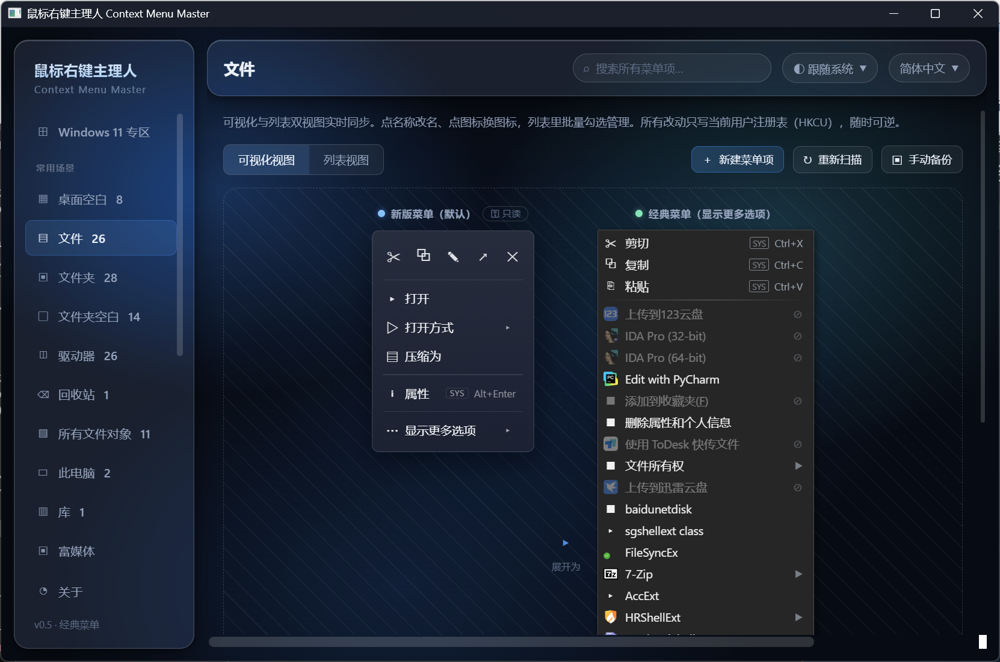
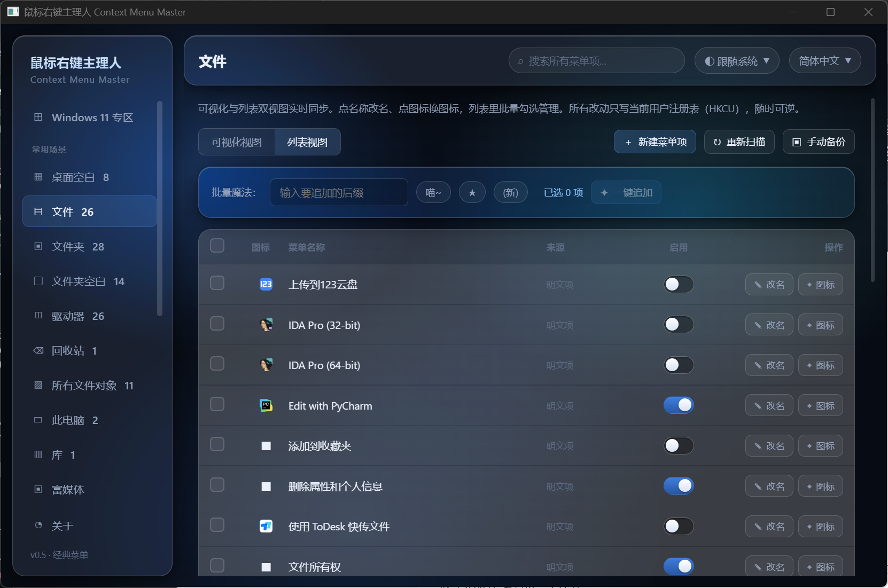
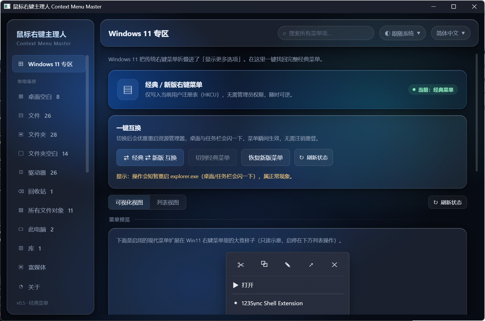
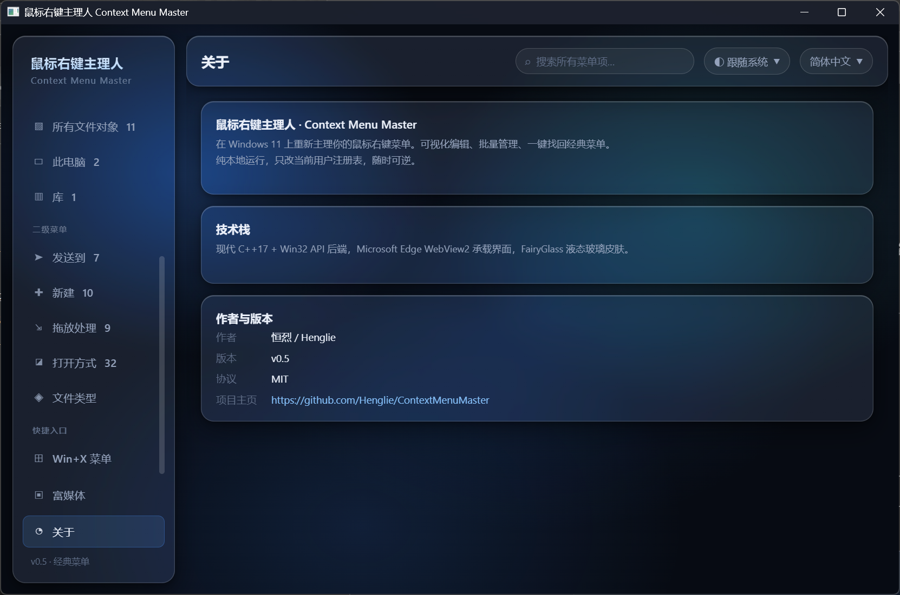
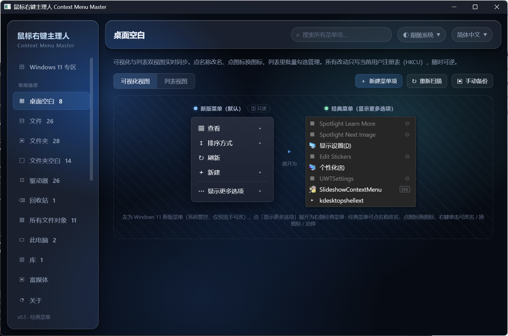
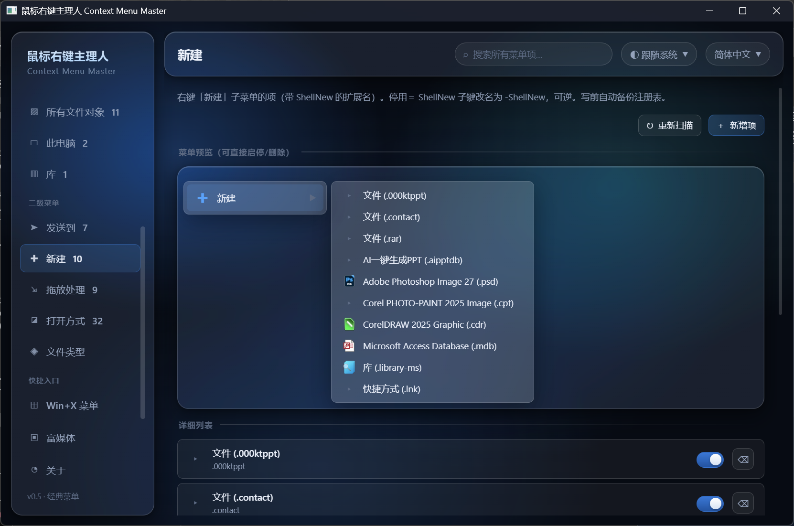

<div align="center">


# 鼠标右键主理人 Context Menu Master

**在 Windows 11 上，把右键菜单重新交回你手里** · 液态玻璃界面 · 纯本地、可逆

[](https://github.com/Henglie/ContextMenuMaster/releases)
[](https://github.com/Henglie/ContextMenuMaster/releases)
[](LICENSE)
[](https://github.com/Henglie/ContextMenuMaster/releases)

<sub>Core-Shell 架构 · C++17 内核 · WebView2 前端 · 16 语言界面</sub>

</div>

---

**简体中文** | [繁體中文](docs/readme/README.zh-TW.md) | [English](README.en.md) | [日本語](docs/readme/README.ja.md) | [한국어](docs/readme/README.ko.md) | [Français](docs/readme/README.fr.md) | [Deutsch](docs/readme/README.de.md) | [Español](docs/readme/README.es.md) | [Português](docs/readme/README.pt.md) | [Русский](docs/readme/README.ru.md) | [Italiano](docs/readme/README.it.md) | [العربية](docs/readme/README.ar.md) | [עברית](docs/readme/README.he.md) | [हिन्दी](docs/readme/README.hi.md) | [ไทย](docs/readme/README.th.md) | [Tiếng Việt](docs/readme/README.vi.md)

> 在 Windows 11 上重新主理你的鼠标右键菜单。

**鼠标右键主理人**是一款 Windows 桌面效能工具。它把杂乱、被折叠、被各种软件塞满的右键菜单交还到你手里：可视化地改名换图标、批量勾选管理、一键找回 Windows 11 被藏起来的经典菜单，并覆盖桌面 / 文件 / 文件夹 / 驱动器 / 回收站 / Win+X / 发送到 / 新建 / 拖放等全部右键场景。

纯本地运行，写操作前自动备份注册表，所有操作随时可逆。以管理员身份运行以便管理系统与所有用户（HKLM）范围的菜单项。

> [!WARNING]
> **富媒体右键扩展（`CmmShellExt.dll`）目前是实验性功能。** 它是一个进程内 COM Shell 扩展，需要管理员手动 `regsvr32 CmmShellExt.dll` 注册后才生效，注册后右键文件才会显示带真实缩略图的菜单项。这部分尚未经过大范围真机验证，在个别系统、个别文件类型或安全软件环境下可能表现不稳定甚至不显示。它内置了护栏（压缩包超 200MB 或枚举超 800ms 自动降级为普通菜单项，不会卡住右键菜单），但仍不建议在重要环境长期挂着。主程序的菜单管理功能不依赖它，可放心单独使用。

---

## 界面截图

> 首屏为可视化视图：左侧栏平铺全部右键场景，中间「现代菜单只读示意 → 经典菜单可编辑」并排呈现。



<table>
  <tr>
    <td width="50%"><br/><sub>列表视图：复选框批量勾选、启停开关、批量魔法工具栏</sub></td>
    <td width="50%"><br/><sub>Windows 11 专区：经典/新版菜单一键互换，优雅重启 Explorer</sub></td>
  </tr>
  <tr>
    <td width="50%"><br/><sub>新建（ShellNew）：管理「新建」子菜单里出现哪些文件类型</sub></td>
    <td width="50%"><br/><sub>桌面空白：可视化视图 1:1 仿真右键菜单</sub></td>
  </tr>
  <tr>
    <td colspan="2" align="center"><br/><sub>关于：版本 / 协议 / 作者与项目主页</sub></td>
  </tr>
</table>

---

## 它解决什么问题

| 场景 | 没有本工具 | 有了本工具 |
|---|---|---|
| Win11 右键菜单太精简，常用项被折进「显示更多选项」 | 每次多点一下、多等一下 | 一键切回完整经典菜单，瞬间生效 |
| 装的软件往右键菜单塞了一堆项，又乱又长 | 只能去注册表里手动翻 | 列表视图批量勾选，一眼管理 |
| 想给菜单项改个顺眼的名字或图标 | 得懂注册表结构才敢动 | 可视化视图里点一下就改 |
| 想统一给一批菜单项加个标记 | 一个个手动改 | 批量魔法，勾选后一键追加后缀 |

---

## 核心功能

- **全右键场景覆盖**：一个侧栏纵向平铺所有右键场景，点一下即切换——
  - **注册表场景**：桌面空白、文件、文件夹、文件夹空白、驱动器、回收站、所有文件对象、此电脑、库。
  - **Win+X 菜单**：管理「右键开始按钮 / Win+X」那个高级菜单（分组显示、启停、新增自定义项、删除）。
  - **发送到（SendTo）**：管理右键「发送到」子菜单的项，可启停、新增、删除。
  - **新建（ShellNew）**：管理右键「新建」子菜单里出现哪些文件类型，逐项启停。
  - **拖放处理程序（DragDrop）**：管理右键拖放文件时弹出的菜单扩展。
  - **打开方式（Open with）**：查看注册为「打开方式」候选的应用（只读）。
  - **此电脑图标（Drive Icons）**：管理「此电脑」盘符界面里第三方软件（云盘、网盘）塞的快捷图标。扫描 MyComputer\NameSpace，一键删除/启停，写前自动备份注册表。
- **双视图实时同步**
  - **可视化视图（WYSIWYG）**：1:1 模拟 Windows 真实右键菜单，点名称改名、点图标换图标，**右键单击菜单项弹出操作菜单（改名 / 换图标 / 启用停用）**，所见即所得。
  - **列表视图（List View）**：传统表格，复选框批量勾选，启停开关、改名换图标按钮一应俱全，适合一次管理一批菜单项。
- **批量魔法**：勾选若干菜单项，一键给它们全部追加同一个后缀（如「 喵~」「 ★」），也可自定义。
- **Windows 11 专区**
  - **经典菜单一键互换**：在 HKCU 写入空 `InprocServer32` 让新版菜单扩展失效，资源管理器回落到 Win10 经典菜单；并优雅重启 `explorer.exe`，菜单瞬间生效，无需注销重登。再点一下即可恢复。
  - **新版菜单扩展（开发中）**：预留扫描与接管 Win11 `IExplorerCommand` 稀疏包（MSIX）扩展项的接口。
- **多语言**：内置 16 种语言界面，首启按系统显示语言自动选，界面右上角可随时切换。
- **纯本地、可逆**：只读写当前用户注册表，不联网、不上传，删键即恢复系统默认。

---

## 快速上手

1. 从 [Releases](https://github.com/Henglie/ContextMenuMaster/releases) 下载对应架构的 zip（多数电脑选 x64），解压到任意目录。
2. 双击 `ContextMenuMaster.exe`，在弹出的 UAC 提示里点「是」授予管理员权限（用于读写第三方软件写在 `HKLM` 的菜单项，不提权则只能改当前用户的项）。
3. 无需安装、无需联网。首次运行会按系统语言自动选择界面语言，右上角可在 16 种语言间随时切换。

---

## 使用方法

### 1 · 选场景

左侧栏纵向平铺全部右键场景，分三组：

- **常用场景**：桌面空白、文件、文件夹、文件夹空白、驱动器、回收站、所有文件对象、此电脑、库 —— 对应你在不同对象上点右键看到的菜单。
- **二级菜单**：发送到、新建、拖放、打开方式、文件类型 —— 右键菜单里的子菜单与按扩展名管理。
- **快捷入口**：Win+X（右键开始按钮的高级菜单）。

顶部还有 **Windows 11 专区** 和 **富媒体** 两个独立入口。点任意场景即扫描该场景的真实菜单项，标签角标显示项数。

### 2 · 改菜单

两种视图，右上角切换，数据实时同步：

- **可视化视图**：1:1 仿真 Windows 右键菜单。
  - 点菜单项 **名称** 直接改名；点 **图标** 换图标。
  - **右键单击** 任意菜单项，弹出操作菜单：改名 / 换图标 / 启用停用 / 删除（自建项）。
  - 现代菜单一侧是只读示意（Win11 现代菜单不受注册表控制，见下方说明），经典菜单一侧可编辑。
- **列表视图**：传统表格，适合批量操作。
  - 每行有启停开关、改名 / 换图标按钮。
  - 勾选多行后，用 **批量魔法** 给它们一键追加统一后缀（如「 ★」），也可自定义。

改名 / 换图标 / 启停对系统内建项会二次确认；每次写注册表前自动备份到 `%LOCALAPPDATA%\ContextMenuMaster\backups\`，改坏了可还原。

### 3 · 找回经典菜单（Windows 11）

进 **Windows 11 专区**，点「切换为经典菜单」：程序会让新版菜单扩展失效并优雅重启 `explorer.exe`，右键菜单瞬间回到 Win10 完整样式，无需注销重登。再点一下即恢复新版菜单。

### 4 · 新建自己的菜单项

列表视图工具栏点「新建菜单项」，填显示名称、执行类型（运行程序 / 打开文件夹 / 打开网址 / 自定义命令行）、目标路径、图标（可选，支持任意图片自动转 ICO）、位置（顶部 / 底部）。自建项带专属标记，可随时编辑或删除，删除只清本工具建的项，不碰系统关联。

> **关于 Win11 现代菜单**：Windows 11 的新版右键菜单只接纳带包标识（MSIX / 稀疏包）的 `IExplorerCommand` 扩展，传统注册表菜单项一律被折进「显示更多选项」的经典菜单里——这是系统设计，与权限无关。所以本工具管理的是经典菜单层；想让常用项回到顶层，用上面的「找回经典菜单」。

---

## 实战案例

下面几个是最常见的使用场景，照着做一遍就能上手。

### 案例一：右键菜单被软件塞爆，清理到只剩常用项

装了网盘、压缩软件、播放器、下载工具之后，右键一个文件冒出十几项，找「复制」都要扫半天。

1. 左侧栏点 **文件**（或 **所有文件对象**，后者对任意文件都生效）。
2. 右上角切到 **列表视图**，一眼看全所有项和它们的来源（哪个软件加的）。
3. 把用不上的项逐个关掉启停开关——比如某网盘的「上传到…」、某播放器的「加入播放列表」。
4. 关掉的项只是加了停用标记，随时能开回来，不删数据。


> 提示：不确定某项是干嘛的，先看它的「来源」列（DLL / 命令行），或先关掉试试——所有操作可逆，改坏了从 `%LOCALAPPDATA%\ContextMenuMaster\backups\` 还原。

### 案例二：Win11 右键太精简，一键换回 Win10 完整菜单

Win11 默认右键把常用项藏进「显示更多选项」，每次多点一下。

1. 顶部进 **Windows 11 专区**。
2. 点 **切换为经典菜单**。
3. 程序会优雅重启 `explorer.exe`（桌面、任务栏闪一下是正常的），右键菜单立刻回到 Win10 完整样式。
4. 想换回新版菜单，再点一下 **恢复新版菜单** 即可。


### 案例三：给一批菜单项统一加个记号

想把自己加的几个菜单项都打上标记，方便一眼认出来。

1. **列表视图** 里勾选要处理的多行。
2. 底部 **批量魔法** 工具栏输入后缀（如「 ★」或「 喵~」）。
3. 点 **一键追加**，勾选的项名字末尾统一加上该后缀。

### 案例四：管理「新建」菜单里冒出来的文件类型

右键「新建」子菜单里塞了一堆用不到的文件类型（各种软件的工程文件）。

1. 左侧栏 **二级菜单** 组里点 **新建（ShellNew）**。
2. 逐项启停：关掉不想在「新建」里看到的类型。
3. 启停走「搬到停用镜像」，随时可原样搬回。


### 案例五：加一个自己的右键菜单项

想右键直接「用某程序打开」或「打开常用文件夹」。

1. **列表视图** 工具栏点 **新建菜单项**。
2. 填显示名称、执行类型（运行程序 / 打开文件夹 / 打开网址 / 自定义命令行）、目标路径。
3. 图标可选，支持选任意图片自动转 ICO；位置可放顶部或底部。
4. 保存即生效。自建项带专属标记，删除只清本工具建的项，不碰系统关联。

---

## 多语言

界面支持 16 种语言：简体中文、繁體中文、English、日本語、한국어、Français、Deutsch、Español、Português、Русский、Italiano、العربية、עברית、हिन्दी、ไทย、Tiếng Việt。

首次启动时，C++ 后端用 Win32 API 读取系统默认显示语言，在 WebView2 页面创建前注入给前端：

- 系统语言命中上述任一种 → 直接用对应语言渲染（中文按简繁细分）。
- 系统语言不在其中 → 一律回退英文（en）。

界面右上角可随时手动切换，选择记入本地存储。阿拉伯语、希伯来语为从右向左（RTL）语言，切到这两种时界面整体镜像布局。

全部语言资源集中在 `ui/i18n.js` 一个文件里，新增一门语言只改这一处即可，无需动界面代码。

---

## 技术栈与架构

| 层 | 选型 | 说明 |
|---|---|---|
| 后端引擎 | 现代 C++17 / MSVC | Win32 API 母语直调 |
| 展现层 | Microsoft Edge WebView2 | webview 单头库承载系统自带 WebView2 |
| 通信桥梁 | WebMessage / postMessage | `w.bind` 暴露后端函数，前端 `await window.fn()` 调用 |
| 界面 | Vue 3（本地） | 单文件应用 |
| 视觉系统 | FairyGlass | 微蓝暗色液态玻璃设计系统，令牌内联复刻进 `ui/index.html` |
| 构建 | CMake + Ninja | VS2022「打开文件夹」即识别 |

**架构：Core-Shell（通用内核 + 原生外壳）**，与姊妹项目 FairySave 一致：`src/platform/windows` 是 Win32 特权层（i18n 检测、注册表菜单接管），`ui/` 是表现层。

**兼容性**：Windows 10 / 11（经典菜单接管为 Win11 特性）。需 WebView2 运行时（Win10/11 自带）。

---

## 开发与构建

**环境**：VS2022（含 C++ 桌面负载、CMake、Ninja、Windows SDK）+ WebView2 运行时。

**最简方式**：VS2022「打开本地文件夹」选中本目录，自动读 `CMakePresets.json` 识别为 CMake 工程，选 `windows-debug` 或 `windows-release` 预设生成、运行。

**命令行方式**（vcvars64 环境下）：

```bat
cmake --preset windows-release
cmake --build build/release
```

产物：

- `build/release/bin/ContextMenuMaster.exe` —— GUI 主程序（WIN32 子系统，无控制台）。
- `build/release/bin/CmmCli.exe` —— 命令行调试探针（验证后端用，非最终用户面向）。

> 改完 `ui/` 后若只动了 HTML，需手动把 `ui/` 同步到 exe 旁的 `ui/` 目录（CMake 的 POST_BUILD 仅在重新链接时触发）。

---

## 目录结构

```
ContextMenuMaster/
├── CMakeLists.txt              CMake 主配置（≈ .sln，含 /utf-8 /EHsc + Release 瘦身）
├── CMakePresets.json           VS 一键识别（windows-debug / release / release-x86 / release-arm64）
├── src/
│   ├── main.cpp                CLI 调试入口（CmmCli）
│   ├── app/
│   │   ├── gui_main.cpp        GUI 入口 WinMain：webview 窗口 + bind + 语言注入
│   │   └── app.manifest        UAC requireAdministrator 提权清单
│   ├── platform/windows/       Win32 特权层（每个右键场景一个模块）
│   │   ├── i18n.{h,cpp}          系统语言检测（16 种语言，按系统显示语言归一化）
│   │   ├── context_menu.{h,cpp}  Win11 经典↔新版菜单接管 + 优雅重启 Explorer
│   │   ├── menu_scanner.{h,cpp}  注册表场景扫描 + 改名/图标/启停/批量后缀
│   │   ├── icon_extract.{h,cpp}  系统图标/资源/.ico → PNG base64 data URI
│   │   ├── image_icon.{h,cpp}    任意图片 → 多尺寸 PNG-in-ICO（富媒体阶段 1）
│   │   ├── com_menu_probe.{h,cpp} IContextMenu COM 扩展动态菜单探测
│   │   ├── win11menu.{h,cpp}     Win11 现代菜单（PackagedCom / SystemCommandStore）
│   │   ├── winx_menu.{h,cpp}     Win+X 菜单（文件系统 .lnk + hash）
│   │   ├── sendto_menu.{h,cpp}   发送到子菜单
│   │   ├── shellnew_menu.{h,cpp} 新建子菜单
│   │   ├── dragdrop_menu.{h,cpp} 拖放处理程序
│   │   ├── openwith_menu.{h,cpp} 打开方式
│   │   ├── custom_menu.{h,cpp}   自建右键菜单项
│   │   ├── filetype_menu.{h,cpp} 按扩展名管理文件类型右键项
│   │   └── drive_icons.{h,cpp}   此电脑盘符图标（MyComputer\NameSpace）
│   └── shellext/               富媒体 Shell 扩展 DLL（阶段 2，独立不链 cmm_core）
│       ├── shellext.cpp          IContextMenu 进程内 COM 服务器 + owner-draw 缩略图
│       └── shellext.def          COM 四导出
├── third_party/                webview 单头库 + WebView2 SDK
└── ui/
    ├── index.html              单文件 Vue3 应用（液态玻璃皮肤）
    ├── i18n.js                 16 语言资源（新增语言只改这一个文件）
    ├── vue.global.js           Vue 3 运行时（本地）
    └── liquidGlass.js          液态玻璃辅助
```

---

## 隐私与安全

- **纯本地**：不联网、不上传任何内容。
- **需管理员权限**：第三方软件的菜单项常注册在 `HKLM`（所有用户），其停用标记也多在 `HKLM`，纯用户态改不动。故程序启动时请求管理员权限，直接读写菜单项真实所在的注册表位置，以支持「所有项都能启停 / 改名」。
- **写前自动备份**：每次改注册表前先 `reg export` 备份对应键到本地 `%LOCALAPPDATA%\ContextMenuMaster\backups\`。
- **可逆**：经典菜单接管随时删键恢复；启停走「加删标记 / 搬到停用镜像」，可原样搬回；删除项一律送回收站。不破坏系统文件。

---

## 下载

- 预编译版见 [Releases](https://github.com/Henglie/ContextMenuMaster/releases)：按 CPU 架构选 zip（x64 / x86 / arm64），解压后双击 `ContextMenuMaster.exe` 即用，无需安装。绝大多数电脑选 x64。
- 需 WebView2 运行时（Windows 10/11 自带）。

---

## 许可与作者

- **作者**：恒烈 (EternalBlaze / Henglie)
- **版本**：v0.7
- **项目主页**：<https://github.com/Henglie/ContextMenuMaster>
- **协议**：MIT
